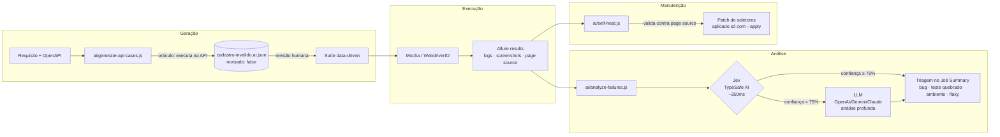

# QA Automation com IA — Desafio Banco Carrefour

Automação de testes de **API** e **Mobile** com uma **camada de IA** aplicada à geração, execução, manutenção e análise dos testes.

| | Stack |
|---|---|
| API | Node.js · Mocha · Chai · Axios · AJV (contrato) · Allure |
| Mobile | WebdriverIO v9 · Appium 3 (UiAutomator2 / XCUITest) · Mocha · Chai · Allure · BrowserStack |
| IA | **Triagem híbrida**: Jev (TypeSafe AI) para decisões rápidas + OpenAI/Gemini/Claude para análise profunda · saída estruturada validada com JSON Schema (AJV) |
| CI/CD | GitHub Actions (API, IA, emulador Android e simulador iOS) · GitLab CI/CD (API, IA e Android em aparelhos reais no BrowserStack) |

## Resultados

| Suíte | Ambiente | Resultado |
|---|---|---|
| API | ServeRest local, Node.js 22 | **54/54** ✅ (3 casos gerados por IA e revisados por mim), mais **5 divergências conhecidas que falham por design** ⚠️ (seção 3 — jobs separados com `allow_failure`, documentam bugs reais da ServeRest) |
| Mobile · Android | Emulador Pixel 7: Android 14 (API 34) no Mac, Android 12 (API 31) no pipeline | **13/13** ✅ nos dois: os 10 cenários, com o CT03 rodando 4 conjuntos de dados (2 min 10 s no Mac) |
| Mobile · iOS | Simulador iPhone 17 Pro, iOS 26.5 (Mac e GitHub Actions) | **13/13** ✅: os mesmos 10 cenários, no Mac e no pipeline. No iOS 27 os campos de senha do cadastro ainda se comportam diferente (ficam com 1 caractere); a validação oficial é no 26.5, a mesma versão do runner do GitHub |
| Mobile · Android real | BrowserStack pelo GitLab CI/CD: Samsung Galaxy S23 (Android 13) e Google Pixel 8 (Android 14), em paralelo | **13/13** ✅ nos dois aparelhos |
| Camada de IA | Testes unitários (`node --test`) | **18/18** ✅ (7 self-healing + 11 triagem híbrida Jev+LLM) |
| Geração de casos com IA | OpenAI `gpt-4o-mini`, execução real | 9 casos propostos: 3 aprovados, 1 bug provável (KI-05) e 5 rejeitados com justificativa. Detalhes em [docs/evidencias/geracao-ia-openai.md](docs/evidencias/geracao-ia-openai.md) |
| Triagem híbrida | Jev (TypeSafe AI) + LLM, execução real | **50% economia de tokens**: casos óbvios resolvidos pelo Jev em ~350ms, incertos vão para LLM. Detalhes na [seção 2](#triagem-híbrida-jev-typesafe-ai--llm) |

**Pipeline:** com a suíte mobile completa (Android + iOS em paralelo), a execução inteira leva cerca de 8 min. O job do iOS caiu de ~22 min para ~7,5 min depois das otimizações da seção 5.

Os screenshots da execução Android estão em [docs/evidencias/android](docs/evidencias/android). Também está documentado o caso real do self-healing, que diagnosticou "tela errada" na primeira execução: [docs/evidencias/self-heal-1a-execucao.md](docs/evidencias/self-heal-1a-execucao.md).

---

## Sumário
1. [Visão geral e arquitetura](#1-visão-geral-e-arquitetura)
2. [Como a IA é aplicada](#2-como-a-ia-é-aplicada)
3. [Desafio de API](#3-desafio-de-api)
4. [Desafio Mobile](#4-desafio-mobile)
5. [Pipeline CI/CD](#5-pipeline-cicd)
6. [Como executar](#6-como-executar)
7. [Decisões técnicas](#7-decisões-técnicas)

---

## 1. Visão geral e arquitetura

```
carrefour-qa-ai/
├── api/        # Desafio de API (ServeRest)
├── mobile/     # Desafio Mobile (native-demo-app)
├── ai/         # Camada de IA compartilhada pelos dois desafios
├── docs/       # Matriz de cobertura
├── .github/workflows/ci.yml
└── .gitlab-ci.yml
```



**Princípio central:** a IA **nunca decide se um teste passou ou falhou**. Ela gera, sugere e analisa; as asserções continuam determinísticas. Toda saída da IA é estruturada (JSON Schema) e **validada por código** antes de ser usada: casos gerados são executados contra a API, seletores sugeridos são conferidos no page source real.

## 2. Como a IA é aplicada

| Etapa | O que faz | Onde |
|---|---|---|
| **Geração** | Lê o requisito do desafio, o contrato OpenAPI e os casos existentes, e propõe casos negativos novos (fronteira, tipos, injeção, combinações). Cada caso é **executado contra a API** e marcado como `confere` ou `DIVERGE`. Só entra na suíte depois de um humano marcar `"revisado": true`. | `ai/generate-api-cases.js` → `api/data/*.ai.json` |
| **Execução** | Os casos revisados rodam no mesmo teste data-driven dos casos manuais, identificados no Allure com a tag `origem:ia`. No mobile, cada falha grava automaticamente a evidência que a IA vai precisar: screenshot, page source XML e um registro estruturado. | `api/test/usuarios/cadastrar.spec.js`, `mobile/config/wdio.shared.conf.js` |
| **Manutenção** | *Self-healing assistido*: quando um seletor quebra, a IA recebe o page source e o screenshot e sugere o seletor equivalente. A sugestão é **validada contra o XML real** e vira um patch para `mobile/test/locators.json`, aplicado só com `--apply`, depois de revisão. | `ai/self-heal.js` |
| **Análise** | Lê o `allure-results`, agrupa as falhas por causa-raiz e classifica cada uma (bug de produto, teste quebrado, ambiente, flaky ou divergência de requisito), com evidência e próxima ação. No mobile é multimodal (envia os screenshots). O resultado aparece no **Job Summary** do pipeline. | `ai/analyze-failures.js` |

**Por que o self-healing não é automático em tempo de execução?** Se o teste "se curasse" sozinho durante a execução, uma regressão real (um botão que sumiu da tela) passaria como sucesso. Aqui o teste falha, a IA explica e propõe a correção, e uma pessoa decide. Quando a IA conclui `tela-errada` ou `elemento-ausente`, a recomendación é abrir bug, não mexer no teste.

### Triagem híbrida: Jev (TypeSafe AI) + LLM

Para **economizar tokens e reduzir latência** na análise de falhas, a triagem usa uma arquitetura híbrida em duas camadas:

```
Falha detectada
      │
      ▼
┌─────────────┐     confiança ≥ 75%?      ┌─────────┐
│  Jev (⚡)   │ ───────────────────────►  │ Aceita! │ → Relatório (~350ms, ~$0.00003)
│  TypeSafe   │                           │         │
│  ~350ms     │                           └─────────┘
│  barato     │
└─────────────┘                                  │
      │ confiança < 75%                        │
      ▼                                       │
┌─────────────┐                               │
│  LLM (🧠)   │ ◄─────────────────────────────┘
│  OpenAI/    │     com "dica" do Jev
│  Gemini/    │     (categoria sugerida + distribuição)
│  Claude     │
│  profundo   │
└─────────────┘
      │
      ▼
  Relatório final + métricas de economia
```

- **Jev** ([TypeSafe AI](https://typesafe.ai)): modelo discriminativo que retorna probabilidades calibradas em ~350ms. Resolve casos óbvios (ECONNREFUSED → `ambiente`, elemento não encontrado → `teste-quebrado`) sem gastar tokens de LLM.
- **LLM**: chamado só para casos incertos/ambíguos, recebendo a classificação preliminar do Jev como contexto.
- **Resultado típico**: 50-70% das falhas resolvidas pelo Jev, reduzindo custo e latência pela metade.

| Componente | Arquivo | Custo típico | Latência |
|-----------|---------|-------------|----------|
| Cliente Jev | `ai/src/jev.js` | ~$0.00003/chamada | ~350ms |
| Triagem híbrida | `ai/src/triage.js` | variável | ~0.5-2s |
| Análise de falhas | `ai/analyze-failures.js` | relatório final | — |

**Teste a integração:** `cd ai && npm run test:jev`

**Funciona sem chave de API.** Sem `JEV_API_KEY`, `OPENAI_API_KEY`, `GEMINI_API_KEY` ou `ANTHROPIC_API_KEY`, a triagem usa heurísticas (regras sobre a mensagem de erro), e a geração de casos é pulada. O pipeline nunca quebra por causa da IA.

**Governança:**
- Prompts versionados em `ai/prompts/`.
- Fornecedor (`AI_PROVIDER`) e modelo (`AI_MODEL`) configuráveis: a camada é agnóstica ao LLM, com OpenAI, Gemini e Claude implementados.
- **Jev (TypeSafe AI)** para triagem rápida de falhas antes do LLM, com threshold de confiança configurável (`JEV_CONFIDENCE_THRESHOLD`).
- Uso de tokens registrado no relatório (Jev + LLM separadamente).
- Métricas de economia no relatório final (quantas falhas o Jev resolveu sem LLM).
- Falhas `@known-issue` não gastam tokens (nem Jev, nem LLM).
- Senhas mascaradas nos logs anexados.
- A própria camada de IA tem testes unitários (`ai/test`), incluindo testes da triagem híbrida.

**IA também no desenvolvimento:** este repositório foi construído com apoio do Claude Code, que ajudou a ler o código-fonte do native-demo-app para mapear os `testID`s reais, a sondar o ServeRest para descobrir os comportamentos de borda e a revisar o código. Todas as decisões de estratégia e todas as asserções foram revisadas por mim.

## 3. Desafio de API

**59 testes**: 54 na suíte principal (51 escritos à mão e 3 gerados por IA e revisados) e 5 divergências conhecidas, organizados por endpoint.

| Pasta | Conteúdo |
|---|---|
| `api/src/client` | Cliente HTTP (axios) que anexa request/response de cada chamada ao Allure (log de execução) |
| `api/src/services` | Service Objects (`UsuariosService`, `LoginService`, ...) |
| `api/src/schemas` | Contratos JSON Schema, com `additionalProperties: false` para detectar campos novos ou removidos |
| `api/src/factories` | Massa de dados com Faker e limpeza automática de tudo que a suíte cria |
| `api/data` | Casos data-driven: manuais (`.json`) e gerados por IA (`.ai.json`) |
| `api/test` | Specs por endpoint, autenticação, não funcionais e divergências conhecidas |

A matriz completa endpoint × status × cenário está em **[docs/cobertura-api.md](docs/cobertura-api.md)**.

### Divergências encontradas (requisito/boas práticas × ServeRest)

> ⚠️ **ATENÇÃO — Falhas esperadas no CI:** Os jobs `api-known-issues` (GitHub Actions) e `api-known-issues` (GitLab CI) **vão falhar propositalmente**. Isso é **esperado e correto**: esses testes documentam bugs reais da API ServeRest que violam o requisito ou boas práticas de segurança. Eles rodam num job separado com `allow_failure: true` (GitLab) / `continue-on-error: true` (GitHub) para ficarem **visíveis no relatório, mas sem bloquear o pipeline**. Se esses testes começarem a **passar**, significa que a API foi corrigida — nesse caso, atualize a documentação e remova o `@known-issue`.

Essas divergências descrevem o comportamento **esperado**, falham hoje e rodam num job separado (`@known-issue`) que não bloqueia o pipeline:

| Id | Severidade | Divergência | Status no CI |
|---|---|---|---|
| KI-01 | 🔴 Crítica | A API aceita `Fulano@x.com` e `fulano@x.com` como contas diferentes (e-mail tratado como case-sensitive) | ❌ Falha esperada |
| KI-02 | 🔴 Crítica | `GET /usuarios` devolve a **senha em texto puro** | ❌ Falha esperada |
| KI-03 | 🟡 Normal | O requisito pede limite de 100 req/min; a API não aplica rate limit (nenhum 429) | ❌ Falha esperada |
| KI-04 | 🟢 Menor | Recurso inexistente retorna 400 em vez de 404 | ❌ Falha esperada |
| KI-05 | 🟡 Normal | Nome só com espaços é aceito. **Encontrado pela geração de casos com IA** (CAD-IA-05) e confirmado na revisão | ❌ Falha esperada |

**Por que testes que falham?** Em vez de deixar divergências como comentários no código (que ninguém lê), cada uma vira um **teste executável** que:
1. **Documenta** o comportamento esperado vs. real
2. **Acompanha** se a API um dia for corrigida (o teste passa → sinal de que o bug foi resolvido)
3. **Não bloqueia** o pipeline (job separado com `allow_failure`)
4. **Não gasta tokens de IA** (marcados como `@known-issue`, vão direto para triagem heurística)

Também documentado: `PUT` em id inexistente **cria** o usuário (upsert, 201), e a suíte cobre esse comportamento.

## 4. Desafio Mobile

App: [native-demo-app](https://github.com/webdriverio/native-demo-app), versão fixada em **v2.2.0** para a execução ser reproduzível.

| # | Cenário | Categoria |
|---|---|---|
| CT01 | Login com credenciais válidas (alerta de sucesso) | Login/Cadastro |
| CT02 | Cadastro com dados válidos | Login/Cadastro |
| CT03 | Validações do login — **data-driven** (`test/data/login-invalido.json`, 4 conjuntos) | Mensagens de erro |
| CT04 | Cadastro com confirmação de senha diferente | Mensagens de erro |
| CT05 | Navegação por todas as abas da barra inferior | Navegação |
| CT06 | Navegação pelo menu lateral até telas fora da barra (Permissions, Data) | Navegação |
| CT07 | Swipe no carrossel até o último card | Navegação/gestos |
| CT08 | Campo de texto refletido na tela + switch ON/OFF | Formulários |
| CT09 | Seleção no dropdown | Formulários |
| CT10 | Botão ativo abre alerta; botão inativo não reage | Formulários |

**Organização:**
- **Page Objects** em `mobile/test/pageobjects`.
- **Repositório central de seletores** em `mobile/test/locators.json`: um só lugar para manter, e é esse arquivo que o self-healing corrige.
- Os seletores usam os `testID`s do app, lidos direto do código-fonte, e são os mesmos em Android e iOS. Onde a plataforma difere (alertas nativos, dropdown), o JSON tem uma entrada por plataforma.

**Evidências automáticas:**
- Screenshot ao fim de **todo** teste (com `SCREENSHOTS=failures`, só nas falhas).
- Page source XML das falhas.
- Logs do WebdriverIO e do Appium.
- Seção *Environment* do Allure preenchida com os dados reais da sessão: plataforma, dispositivo, versão do SO, driver, commit e pipeline.

**Ambientes:**

| Config | Onde roda |
|---|---|
| `config/wdio.android.conf.js` | Emulador Android (local ou GitHub Actions) |
| `config/wdio.ios.conf.js` | Simulador iOS (macOS). Detecta sozinho o iPhone mais recente instalado |
| `config/wdio.browserstack.conf.js` | Dispositivos Android **reais** no BrowserStack. O app só publica build de iOS para simulador (limitação da Apple documentada pelo projeto), por isso iOS real não é possível com este app |

## 5. Pipeline CI/CD

`.github/workflows/ci.yml` roda em **push**, **pull request**, toda **noite** e sob demanda (*Run workflow*).

**Rodar só o necessário.** Um emulador Android no runner do GitHub não tem GPU e é várias vezes mais lento que no Mac, e o simulador iOS precisa de um runner macOS. Por isso o pipeline decide o que rodar:

| Evento | O que roda |
|---|---|
| PR | Só os jobs das pastas alteradas (`api/`, `mobile/`, `ai/`). No mobile, apenas os cenários `@smoke` no Android (CT01, CT02, CT05, CT08) |
| Push na `main` | Só os jobs das pastas alteradas, com a suíte mobile completa (Android + iOS) se `mobile/` ou `ai/` mudou |
| Toda noite (03:00) e *Run workflow* | Tudo, com a suíte mobile completa |
| Mudança só em README/docs | Nada pesado |

No CI, as esperas dos testes mobile dobram (`WAIT_FACTOR=2`). No Android, cada arquivo de spec tem 1 nova tentativa (`SPEC_RETRIES=1`); no iOS não, para uma falha real aparecer logo. A lógica dos testes não muda; localmente continua tudo como antes.

**Onde o tempo do mobile vai.** Na primeira execução completa, os 6 cenários de navegação e formulários no iOS levaram ~1,5 min; o resto do job era preparação. Por isso as otimizações atacam a preparação, não os testes:
- **iOS:** o WebDriverAgent (a ponte do Appium com o simulador) é baixado já compilado, na mesma versão do driver, em vez de ser compilado no Xcode a cada execução. Se o download falhar, o Appium compila como antes.
- **Android:** o emulador já ligado fica em cache (snapshot do AVD), e as execuções seguintes voltam dele em vez de dar boot do zero.
- Paralelizar os arquivos de spec em várias máquinas foi avaliado e descartado por enquanto: cada máquina pagaria de novo o boot e a preparação, que são a maior parte do tempo.


| Job | O que faz | Falha esperada? |
|---|---|---|
| IA · testes unitários | Testa a própria camada de IA (18 testes: self-healing + triagem híbrida Jev/LLM) | ❌ Não — deve sempre passar |
| API · ServeRest | Sobe o ServeRest **local no runner**, roda a suíte principal (54 testes), gera o Allure e a triagem por IA | ❌ Não — deve sempre passar |
| API · Divergências conhecidas | Roda os 5 testes `@known-issue` (KI-01 a KI-05) que documentam bugs reais da ServeRest | ⚠️ **SIM — falha esperada!** `allow_failure: true` / `continue-on-error: true`. Se passar, a API foi corrigida → atualizar docs |
| Mobile · Android | Emulador Pixel 7 / Android 12 (API 31), 4 núcleos e 4 GB (`android-emulator-runner`), Allure, triagem e self-healing | ❌ Não — deve sempre passar |
| Mobile · iOS | Simulador em `macos-latest` (iOS 26.5), WebDriverAgent pré-compilado, Allure, triagem e self-healing | ❌ Não — deve sempre passar |
| BrowserStack | Execução manual (*Run workflow*) em dispositivos reais | ❌ Não — deve sempre passar |
| Gerar casos com IA | Execução manual: gera os casos e publica o JSON como artefato para revisão. **Nunca commita sozinho** | ❌ Não — deve sempre passar |

> 💡 **Sobre as divergências conhecidas:** Os jobs de `api-known-issues` (GitLab) e `Divergências conhecidas` (GitHub Actions) **falham de propósito**. Eles documentam 5 bugs reais da API ServeRest (senha em texto puro, e-mail case-sensitive, sem rate limit, etc.). Rodam separados com `allow_failure` para ficarem visíveis sem bloquear o pipeline. **Leia mais na [seção 3](#divergências-encontradas-requisitoboas-práticas--serverest).**

Relatórios, evidências e triagens ficam como **artefatos** de cada execução. O `.gitlab-ci.yml` roda no GitLab CI/CD, como pede o desafio mobile: o mesmo código está espelhado em [gitlab.com/rafaelsilvabarbosabrbs73/carrefour-qa-ai](https://gitlab.com/rafaelsilvabarbosabrbs73/carrefour-qa-ai). Lá os jobs também são filtrados por pasta (`rules: changes`). Como os runners compartilhados do GitLab não têm KVM nem macOS, o mobile roda em **aparelhos Android reais no BrowserStack** (Galaxy S23 e Pixel 8 em paralelo), com vídeo e logs de cada sessão no painel do BrowserStack. Variáveis no GitLab: `BROWSERSTACK_USERNAME`, `BROWSERSTACK_ACCESS_KEY`, `OPENAI_API_KEY` e `JEV_API_KEY` (mascaradas).

**Secrets** (todos opcionais): `OPENAI_API_KEY`, `GEMINI_API_KEY` ou `ANTHROPIC_API_KEY`, `JEV_API_KEY` (TypeSafe AI — triagem híbrida), `BROWSERSTACK_USERNAME`, `BROWSERSTACK_ACCESS_KEY`.

## 6. Como executar

Pré-requisito: Node.js 20 ou superior. Copie `.env.example` para `.env` se for usar IA ou BrowserStack.

### 🔐 Variáveis de ambiente (`.env`)

O arquivo `.env` **não é versionado** (está no `.gitignore`). Ele fica **somente local** na sua máquina. As chaves abaixo são **opcionais** — sem elas, o projeto funciona em modo heurístico (sem IA generativa):

| Variável | Obrigatória | Para que serve | Onde obter |
|---|---|---|---|
| `JEV_API_KEY` | Opcional | **Triagem híbrida de falhas** (Jev/TypeSafe AI). Resolve casos óbvios em ~350ms, economizando tokens do LLM. | [typesafe.ai](https://typesafe.ai) → API Keys |
| `OPENAI_API_KEY` | Opcional | **LLM para análise profunda** de falhas incertas + geração de casos de teste. Sem Jev, é o único motor de IA. | [platform.openai.com](https://platform.openai.com) |
| `GEMINI_API_KEY` | Opcional | Alternativa ao OpenAI (Google Gemini). | [aistudio.google.com](https://aistudio.google.com) |
| `ANTHROPIC_API_KEY` | Opcional | Alternativa ao OpenAI (Claude/Anthropic). | [console.anthropic.com](https://console.anthropic.com) |
| `BROWSERSTACK_USERNAME` | Opcional | Testes mobile em **dispositivos reais** (Android). | [browserstack.com](https://www.browserstack.com) |
| `BROWSERSTACK_ACCESS_KEY` | Opcional | Chave de acesso do BrowserStack (par com o username). | [browserstack.com](https://www.browserstack.com) |

**Fluxo recomendado (custo otimizado):**

```
┌─────────────────┐     ┌─────────────────┐     ┌─────────────────┐
│  JEV_API_KEY    │ ──► │  Triagem rápida │ ──► │  Casos óbvios   │  ⚡ ~350ms, ~$0
│  (TypeSafe AI)  │     │  (Jev)          │     │  resolvidos     │
└─────────────────┘     └─────────────────┘     └─────────────────┘
                                                        │ confiança < 75%
                                                        ▼
                                               ┌─────────────────┐
                                               │  OPENAI_API_KEY │  🧠 Análise profunda
                                               │  (ou Gemini/    │     só para casos incertos
                                               │   Claude)       │
                                               └─────────────────┘
```

> **Segurança:** Nunca commite o `.env`. No CI/CD (GitHub Actions / GitLab CI), as chaves são configuradas como **secrets mascarados** no painel do repositório, não no código.

### API
```bash
cd api && npm ci
npm run api:start            # terminal 1: ServeRest em http://localhost:3000
npm test                     # terminal 2: suíte principal
npm run test:known-issues    # divergências conhecidas
npm run report:generate && npm run report:open
```
Para rodar contra o ambiente público: `API_BASE_URL=https://serverest.dev API_SLA_MS=3000 npm test`.

### Mobile
Pré-requisitos:
- **Java 17** com `JAVA_HOME` configurado.
- **Android Studio**: SDK, Platform-Tools, Emulator e um AVD, com `ANDROID_HOME` configurado.
- **Xcode** com um simulador de iPhone (para iOS).

```bash
cd mobile && npm ci
npm run drivers:install      # uiautomator2 + xcuitest
npm run apps:download        # baixa o .apk e o .zip do simulador (v2.2.0)

npm run test:android         # com um emulador aberto
npm run test:ios             # sobe o simulador sozinho (1ª execução compila o WebDriverAgent: ~3 min)
npm run test:browserstack    # requer BROWSERSTACK_USERNAME/ACCESS_KEY
npm run report:generate && npm run report:open
```

### Camada de IA
```bash
cd ai && npm ci && npm test
npm run test:jev             # testa a conexão com o Jev (TypeSafe AI)
npm run jev:status           # mostra se o Jev está ativo
npm run generate:api         # gera casos de API (requer uma chave de IA no .env e o ServeRest no ar)
npm run analyze:api          # triagem híbrida (Jev + LLM) das falhas da API
npm run analyze:mobile       # triagem híbrida (Jev + LLM) das falhas mobile
npm run heal                 # sugestões de self-healing
npm run heal -- --apply      # aplica as sugestões validadas em mobile/test/locators.json
```

**Demonstração do self-healing sem device:**
```bash
node self-heal.js --evidence test/fixtures/evidence
```
Nessa fixture, o `testID` do campo de e-mail foi renomeado para `input-login-email`. O script propõe `~input-login-email`, valida no page source e ignora a falha que não é de seletor.

**Caso real:** na primeira execução no emulador, o self-healing diagnosticou `tela-errada` em vez de "consertar" seletores, e isso levou à causa-raiz (ordem dos hooks). Veja [docs/evidencias/self-heal-1a-execucao.md](docs/evidencias/self-heal-1a-execucao.md).

## 7. Decisões técnicas

- **JavaScript com Mocha e Chai nos dois desafios.** Segue a stack sugerida e deixa o repositório uniforme.
- **ServeRest local no CI.** Execução determinística, sem rate limit nem instabilidade de terceiros.
- **Testes independentes.** Cada teste cria a própria massa com Faker e tudo é removido no final, então os testes podem rodar em qualquer ordem.
- **Contrato estrito** (`additionalProperties: false`). Um campo novo na resposta quebra o teste de contrato de propósito.
- **Divergências como testes, não como comentários.** Ficam executáveis e visíveis no relatório, sem bloquear o pipeline.
- **Esperas explícitas, nunca `pause()`.** Para "o alerta não deve aparecer", o teste espera a janela de 2,5 s (o app simula 1,5 s de chamada de API) em vez de checar uma única vez.
- **Avisos do sistema tratados num lugar só** (`mobile/test/support/system-prompts.js`). São avisos do Android ou do iOS, não do app, que aparecem por cima da tela só em alguns ambientes. Exemplo real: no simulador iOS do GitHub, o "Save Password?" do app Senhas cobria o formulário de login depois de digitar a senha (no Mac não aparecia). Num Mac em português apareceram o "Salvar Senha?" e o "Usar Senha Forte?", que ocupa o lugar do teclado no cadastro. O teste fecha o aviso sempre com a opção neutra ("Not Now"/"Agora Não", o "x", "Wait") e digita os próprios dados; nunca aceita senha sugerida nem salva nada.
- **Triagem híbrida Jev + LLM (economia de custos).** O [Jev](https://typesafe.ai) (TypeSafe AI) é um modelo discriminativo que retorna probabilidades calibradas em ~350ms, sem gerar texto. Casos óbvios (ECONNREFUSED → `ambiente`, elemento não encontrado → `teste-quebrado`) são resolvidos pelo Jev com confiança ≥ 75%, sem gastar tokens de LLM. Só casos incertos vão para o LLM, recebendo a classificação preliminar do Jev como contexto. Resultado: **~50-70% de economia** em tokens e latência, mantendo a qualidade da análise profunda quando necessária.
- **IA sugere, pessoa decide: caso real.** No BrowserStack, o CT07 (swipe) falhou só no Galaxy S23. A triagem por IA classificou como "bug de produto, confiança alta", mas o mesmo teste passou no Pixel 8 na mesma execução: o carrossel funcionava, o problema era o gesto naquele aparelho. A causa (o gesto nativo não movia o carrossel na Samsung) foi confirmada pelo screenshot e o teste ganhou conferência de movimento e um gesto alternativo. Por isso a triagem não altera resultado nem abre bug sozinha.
- **IA fora do caminho crítico.** Tem fallback heurístico, saída validada por código e revisão humana antes de qualquer mudança no repositório.
